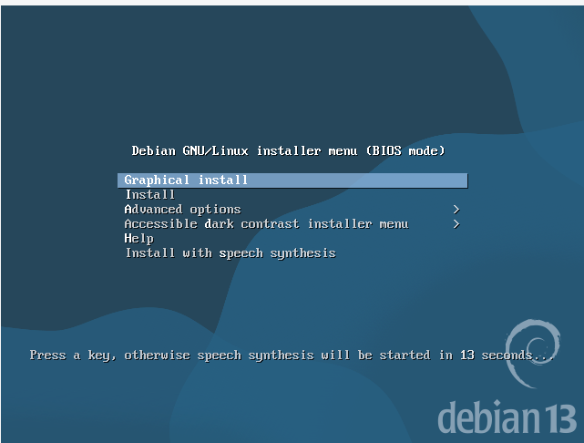
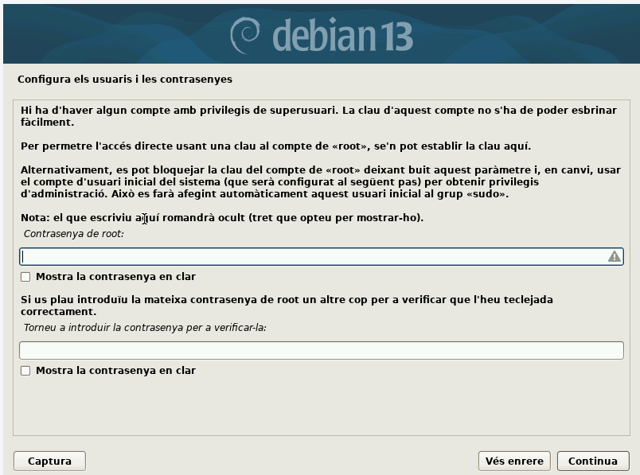
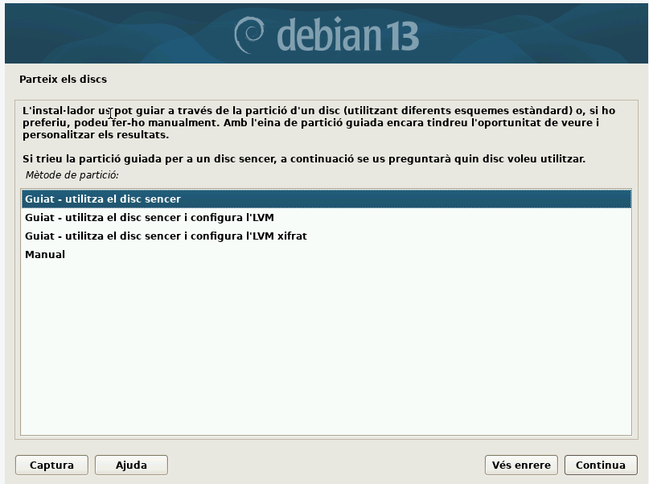
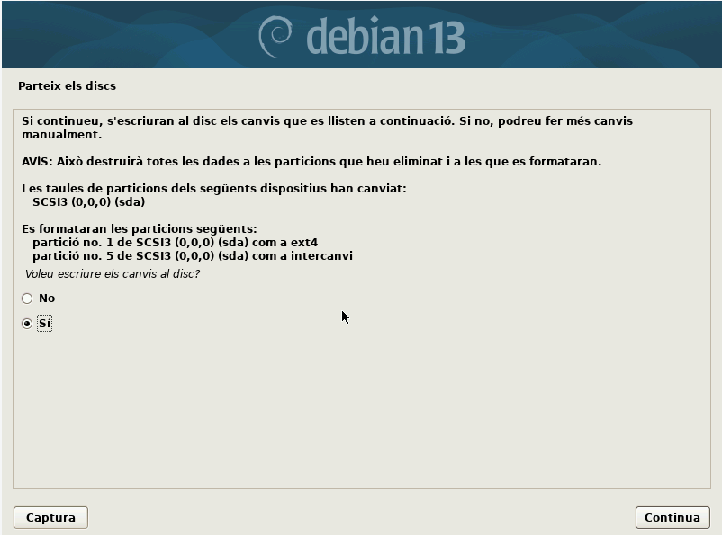
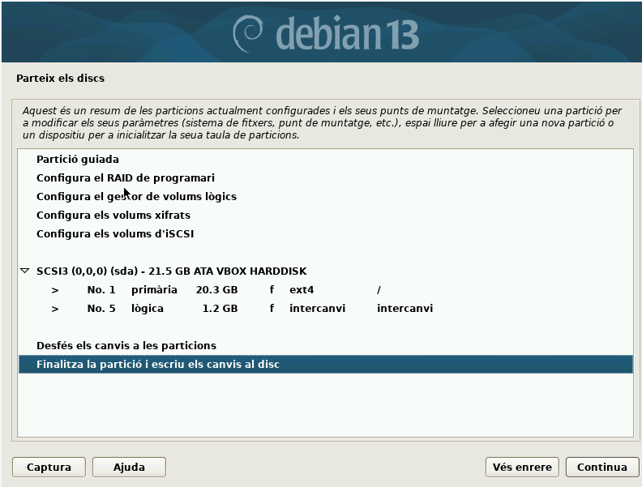
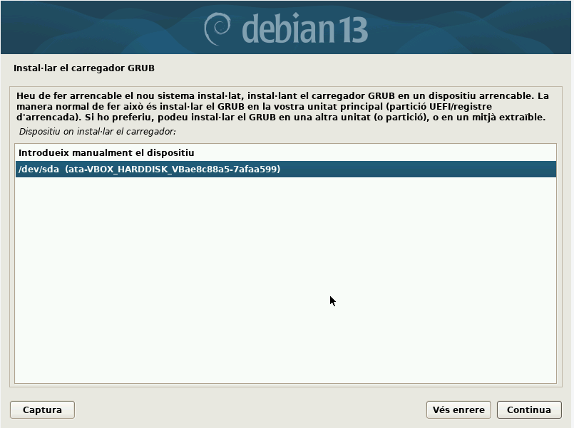

\newpage
\renewcommand\tablename{Tabla}


# 1. Instal·lar Debian sense entorn gràfic

Triem l'opció d'instal·lador gràfic (no instal·larem el GUI)




Les instal·lacions d'Ubuntu deixen, per defecte, l'usuari root inhabilitat i no apareix esta opció. La de Debian, ens dóna l'opció d'habilitar-lo.
No obstant, de moment no ho farem i, per a aixó, deixarem en blanc els camps de contrassenya.





Compte! Trieu correctament el disc on instal·lar. Apareixeran tots els dispositius de magatzenament secundari: 
discos durs interns, externs, pendrives... (sdX, nvmeX, hdX...)











# 2. Treballar amb els terminals

Ara podem accedir als diferents terminals amb *Alt Fn* 

Podem fer proves creant usuaris:

```
sudo useradd joana -s /bin/bash
sudo passwd
```
I iniciant en cada terminal una sessió amb un usuari distint


# 3. Afegir GUI Mínim

|Paquet|Descripció|
|:--|:-----|
|Xorg|Procés del servidor gràfic X11; permet la comunicació amb pantalla i dispositius d’entrada|
|Openbox|Gestor de finestres: disposició, vores, moviment, menús i escriptoris.|
|startx / xinit|Mecanisme que arranca Xorg i la sessió indicada a ~/.xinitrc; no és un escriptori.|
|Firefox / xterm|Aplicacions gràfiques: són clients X11; Openbox administra les seues finestres.|
|LightDM (no instal·lat)|Alternativa gràfica per autenticar-se i iniciar sessions, innecessària per a aquesta pràctica.|


## 3.1 Instal·lem els tres paquets al mateix temps.

1. Abans actualitzame els repositoris (update)
2. Desactivem les opcions recomanades perquè volem instal·lar el mínim GUI (--no-install-recommends).

```
sudo apt update
sudo apt install --no-install-recommends xorg openbox xinit xterm
```

## 3.2 Preparem com iniciar el GUI des del CLI. 

Creem un fitxer ocult amb una línia usant l'editor _nano_

```
nano ~/.xinitrc
```

1. Escrivim a línia: **openbox-session**
2. Guardem el fitxer amb Control X i reponent Sí

Ja podem iniciar el GUI amb
```
startx
```

# 4 Instal·lar un navegador

Un possible ús d'un Linux sense GUI és reciclar màquines obsoletes per navegar o usar aplicacions web. Per això instal·larem un navegador com el Firefox

```
sudo apt install firefox-esr
```


Ara ja el tenim disponible des del GUI en Brownser.

