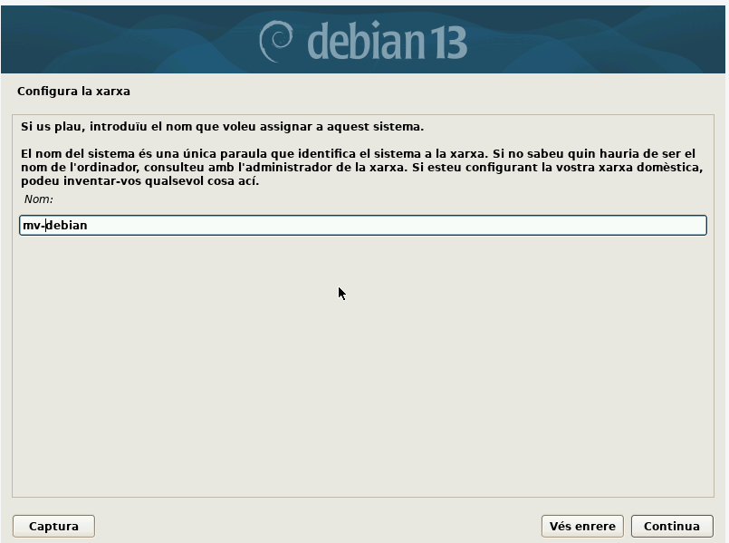
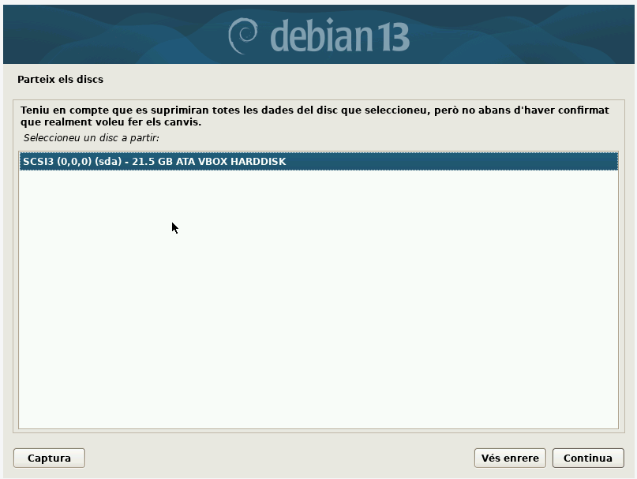
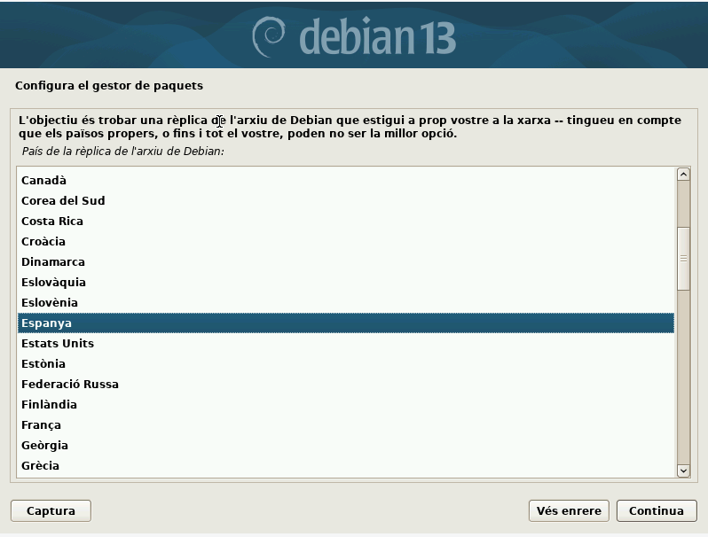
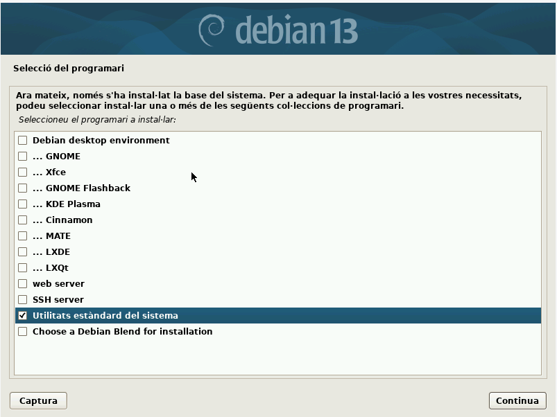
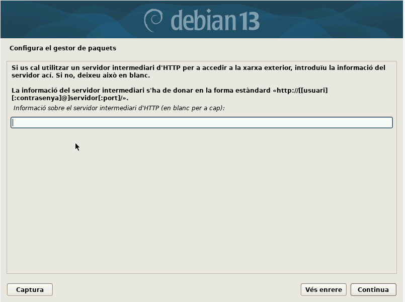
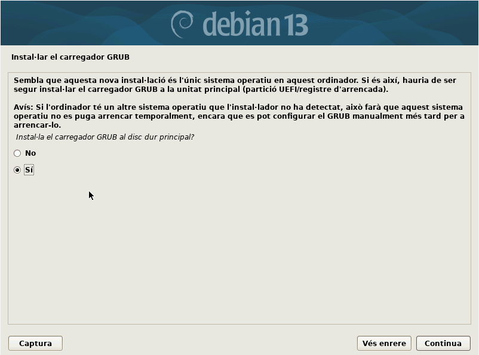

\newpage
\renewcommand\tablename{Tabla}


# 1. Instal·lar Debian sense entorn gràfic

Triem l'opció d'instal·lador gràfic (no instal·larem el GUI)




Les instal·lacions d'Ubuntu deixen, per defecte, l'usuari root inhabilitat i no apareix esta opció. La de Debian, ens dóna l'opció d'habilitar-lo.
No obstant, de moment no ho farem i, per a aixó, deixarem en blanc els camps de contrassenya.


Compte! Trieu correctament el disc on instal·lar. Apareixeran tots els dispositius de magatzenament secundari: 
discos durs interns, externs, pendrives... (sdX, nvmeX, hdX...)













# 2. Afegir GUI Mínim


# 3. Entorn gràfic

## 3.1 Característiques dels gestors de finestres GNOME i KDE
| **Característica**    | **GNOME**                   | **KDE**                     |
|-----------------------|----------------------------|-----------------------------|
| **Disseny**           | Minimalista i senzill      | Personalitzable             |
| **Consum de recursos**| Relatiu alt                | Relatiu moderat             |
| **Eines pròpies**     | Nautilus, GNOME Terminal   | Dolphin, Konsole            |

## 3.2 Altres gestors de finestres
| **Gestor**  | **Característica**                      |
|-------------|----------------------------------------|
| **Fluxbox** | Lleuger i ràpid, minimalista.          |
| **LXDE**    | Lleuger, ideal per a equips antics.    |
| **Xfce**    | Equilibri entre lleugeresa i funcionalitat. |


## 3.3 Exploradors de fitxers
Un explorador de fitxers és l'eina gràfica que permet navegar pel sistema d'arxius. Cada entorn gràfic sol utilitzar un explorador diferent.

| **Explorador** | **Entorn associat** | **Característiques**                     | **Com instal·lar-lo**                     |
|----------------|----------------------|------------------------------------------|-------------------------------------------|
| **Nautilus**   | GNOME               | Senzill i integrat amb GNOME.            | `sudo apt install nautilus`               |
| **Thunar**     | Xfce                | Lleuger i ràpid.                         | `sudo apt install thunar`                 |
| **Dolphin**    | KDE                 | Altament personalitzable i complet.      | `sudo apt install dolphin`                |
| **Caja**       | MATE                | Similar a Nautilus, però amb opcions clàssiques.| `sudo apt install caja`                   |
| **PCManFM**    | LXDE                | Lleuger i senzill.                       | `sudo apt install pcmanfm`                |

### Seleccionar i canviar d'explorador
Pots instal·lar diversos exploradors i executar-los independentment, per exemple:
```bash
nautilus &
thunar &
```
- Configura el predeterminat editant la configuració del sistema o utilitzant eines com **xdg-mime**.

### Desinstal·lació d'exploradors
Si desitges eliminar un explorador de fitxers:
```bash
sudo apt remove <nom_explorador>
sudo apt autoremove
```
Per exemple, per eliminar **Caja**:
```bash
sudo apt remove caja
sudo apt autoremove
```
## 5.6 Preferències
- **Pantalla**: Resolució i configuració de monitors.
- **Ratolí i teclat**: Velocitat, mapes de tecles.
- Comanda per accedir:
  ```bash
  lxappearance
  ```
## 5.8 Instal·lació i desinstal·lació de diferents escriptoris

### Instal·lació d'escriptoris
Pots instal·lar escriptoris alternatius en Ubuntu utilitzant el gestor de paquets **apt**. Després d'instal·lar-los, pots seleccionar quin entorn utilitzar en la pantalla d'inici de sessió.

| **Escriptori** | **Com instal·lar-lo**                     | **Com accedir després d’instal·lar**             |
|-----------------|-------------------------------------------|--------------------------------------------------|
| **GNOME**       | `sudo apt install ubuntu-desktop`         | Tria **GNOME** a la pantalla d’inici de sessió. |
| **LXDE**        | `sudo apt install lubuntu-desktop`        | Tria **LXDE** a la pantalla d’inici de sessió.  |
| **Xfce**        | `sudo apt install xubuntu-desktop`        | Tria **Xfce** a la pantalla d’inici de sessió.  |
| **KDE/Plasma**  | `sudo apt install kubuntu-desktop`        | Tria **Plasma** a la pantalla d’inici de sessió. |
| **Fluxbox**     | `sudo apt install fluxbox`                | Tria **Fluxbox** a la pantalla d’inici de sessió. |

### Desinstal·lació d'escriptoris
Per desinstal·lar un escriptori, elimina els paquets associats. Assegura’t de no eliminar dependències crítiques del sistema.

1. **GNOME**:
   ```bash
   sudo apt remove ubuntu-desktop
   sudo apt autoremove
   ```
2. **LXDE**:
   ```bash
   sudo apt remove lubuntu-desktop
   sudo apt autoremove
   ```
3. **Xfce**:
   ```bash
   sudo apt remove xubuntu-desktop
   sudo apt autoremove
   ```
4. **KDE/Plasma**:
   ```bash
   sudo apt remove kubuntu-desktop
   sudo apt autoremove
   ```
5. **Fluxbox**:
   ```bash
   sudo apt remove fluxbox
   sudo apt autoremove
   ```

### Comprovar escriptoris instal·lats
- Llista els paquets instal·lats relacionats amb els entorns d'escriptori

:
  ```bash
  dpkg -l | grep desktop
  ```

### Selecció de l'escriptori predeterminat
- Si vols canviar l’escriptori predeterminat:
  1. Modifica la configuració de la pantalla d’inici de sessió.
  2. O selecciona’l manualment al moment d’iniciar sessió.
``` 

Aquesta versió completada integra tot el que necessites sobre instal·lació i desinstal·lació d'escriptoris i exploradors de fitxers, amb els passos corresponents per a un entorn Ubuntu. També he inclòs exemples per a cada acció amb les ordres necessàries.