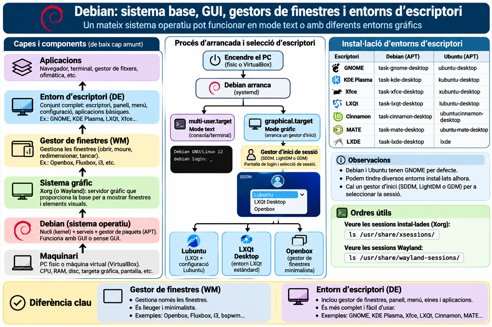
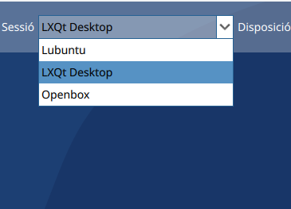

\newpage
\renewcommand\tablename{Tabla}


# 1. El Sistema Operatiu GNU/Linux. Estructura i característiques

## 1.1 El sistema operatiu GNU/Linux
- **GNU/Linux** és un sistema operatiu lliure i de codi obert.
- Basat en el nucli **Linux** i eines del projecte **GNU**.
- Escalable: pot ser utilitzat en dispositius menuts o grans servidors.

## 1.2 Estructura
1. **Nucli (Kernel)**:
   - Gestió de recursos: memòria, CPU, dispositius.
   - Per veure la versió:
     ```bash
     uname -r
     ```
   - Exemple de resultat: `6.8.0-149-generic`

2. **Shell**:
   - Interfície que permet interactuar amb el sistema.
   - Exemples: **bash**, **sh**, **dash**.
  
  Els shells disponibles els tenim al fitxer */etc/shells*
  
  ```bash
  cat /etc/shells
  ```
  
3. **Utilitats**:
   - Comandes bàsiques: `ls`, `cp`, `mv`.

4. **Aplicacions**:
   - Programes per a usuaris finals, com navegadors, editors; usuaris administradors com net-tools, apt o usuaris programadors com Visual-Studio

5. **Sistema d’arxius**:
   - Estructura jeràrquica que comença a `/`.

# 1.3 Característiques
- **Lliure i obert**: Es pot modificar i distribuir.
- **Multiusuari**: Diversos usuaris alhora.
- **Multitasca**: Execució de múltiples processos.
- **Segur**: Model de permisos.
- **Portabilitat**: Funciona en diferents plataformes.

# 2. Evolució històrica
- **1991**: Linus Torvalds crea el nucli Linux.
- **1992**: Es llança com a programari lliure.
- **1994**: Primera versió estable (Linux 1.0).
- **Actualitat**: Moltes distribucions basades en Linux.

# 3. Distribucions
- Una distribució és una combinació del nucli, utilitats GNU, i altres programes.
- Exemples de distribucions:

  | **Distribució** | **Orientació**                      |
  |------------------|------------------------------------|
  | Ubuntu           | Usuaris nous, suport comunitari.  |
  | Debian           | Estable, molt usada en servidors.|           |
  | Arch Linux       | Personalitzable, usuaris experts. |

# 4. Instal·lació de Ubuntu
1. Descarrega la imatge ISO des d'[ubuntu.com](https://ubuntu.com/).
2. Grava-la en un USB amb eines com **Ventoy** ( o Rufus, Etcher).
3. Arranca des del USB i segueix el procés d'instal·lació:
   - Idioma, fus horari, particions.
4. Inicia sessió després de la instal·lació.

# 4.1 Versió d'Ubuntu

Amb l'ordre: 
```bash
lsb_release -a
```
o llegint el fitxer de configuració
```bash
cat /etc/os-release
```
Una vegada més veiem com en un fitxer de text pla es guarda informació del sistema. En este cas:

* Nom del SO
* Distribució
* Versió


# 5. ENTORN GRÀFIC. 

## 5.1 Capes o components




## 5.2 Sistema gràfic i Gestor de finestres

### Sistema gràfic (xorg)


Com infraestructura per crear entorn gràfic (sistema gràfic) usem **xorg*
Per inicar-lo des del CLI usem el paquet **xinti** que ens proporciona el **startx**
```
startx /usr/bin/openbox-session
```
En el tema de Debian has vist com automatizar-ho en el .xinitrc

### Gestor de finestres

|**Gestor de finestres**|Instal·lar: Sistema gràfic + Gestor de finestres + startx|
|:---|-----|
|Openbox|`sudo apt install xorg openbox xinit`|
|IceWM|`sudo apt install xorg xinit icewn`|
|Fluxbox|`sudo apt install xorg xinit fluxbox`|
|i3|`sudo apt install xorg xinit i3-wm`|


## 5.3 Escriptoris

A diferència de Windows, el Linux en tenim més d'un i, a més, en una mateixa màquina podem tindre'n instal·lat més dun i escollir en iniciar.

### Instal·lació d'escriptoris
Pots instal·lar escriptoris alternatius en Ubuntu utilitzant el gestor de paquets **apt**. Després d'instal·lar-los, pots seleccionar quin entorn utilitzar en la pantalla d'inici de sessió.


| Escriptori | Debian | Ubuntu |
|---|---|---|
| **GNOME** | `sudo apt install task-gnome-desktop` | `sudo apt install ubuntu-desktop` |
| **LXQt** | `sudo apt install task-lxqt-desktop` | `sudo apt install lubuntu-desktop` |
| **Xfce** | `sudo apt install task-xfce-desktop` | `sudo apt install xubuntu-desktop` |
| **KDE Plasma** | `sudo apt install task-kde-desktop` | `sudo apt install kubuntu-desktop` |
| **Cinnamon** | `sudo apt install task-cinnamon-desktop` | `sudo apt install ubuntucinnamon-desktop` |
| **MATE** | `sudo apt install task-mate-desktop` | `sudo apt install ubuntu-mate-desktop` |
| **LXDE** | `sudo apt install task-lxde-desktop` | `sudo apt install lxde-desktop` |


### Com cnsultar els que tenim instal·lats?

Si estem usant la infraestructura gràfica Xorg

```
ls /usr/share/xsessions/
```

Si usarem la infraestructura Wayland

```ls /usr/share/wayland-sessions/
```

Per saber quin escriptori estem usant:

```
echo $DG_CURRENT_DESKTOP
```
o també

```echo $DESKTOP_SESSION
```

  
## 5.4 Configurar Gestor d'inici.

Com hem dit podem tindre més d'un escriptori instal·lat al PC. El **Gestor d'inici** és el software que ens permet triar amb quin Esciptori iniciar.

Per saber si ja en tenim un instal·lat:
```
cat /etc/X11/default-display-manager
```

Si no en tenim cap instal·lat cal fer-ho ( instal·lem el *sddm*)

```
sudo apt update
sudo apt install sddm
```

o un altre (el *LigthDM*)

```
sudo update
sudo apt install LightDM
```

Si hem instal·lat els dos, hem d'inicar quin s'iniciarà per defecte:
```
sudo dpkg-reconfigure sddm
```
Imatge del sddm


## 5.5 Arrencar amb i sense GUI

Si volem iniciar sense GUI, podem configurar-ho i reiniciar (reboot)
```
sudo systemctl set-default multi-user.target
sudo reboot
```

Per inicar amb el GUI, farem l'equivalent:

```
sudo systemctl set-graphical.target
sudo reboot
```

### 5.7 Desinstal·lació d'escriptoris

Per desinstal·lar un escriptori, elimina els paquets associats. Assegura’t de no eliminar dependències crítiques del sistema.

**Exemple**

```bash
   sudo apt remove task-gnome-desktop
   sudo apt autoremove
   ```
**Si és el Escriptori en ús (o l'últim que queda), has d'iniciar prèviament sense GUI com hem vist**

   
## 5.8 Exploradors de fitxers
Un explorador de fitxers és l'eina gràfica que permet navegar pel sistema d'arxius. Cada entorn gràfic sol utilitzar un 
explorador que té associat però podem instal·lar altres, desinstal·lar i canviar.

| **Explorador** | **Entorn associat** | **Característiques**                     | **Com instal·lar-lo**                     |
|----------------|----------------------|------------------------------------------|-------------------------------------------|
| **Nautilus**   | GNOME               | Senzill i integrat amb GNOME.            | `sudo apt install nautilus`               |
| **Thunar**     | Xfce                | Lleuger i ràpid.                         | `sudo apt install thunar`                 |
| **Dolphin**    | KDE                 | Altament personalitzable i complet.      | `sudo apt install dolphin`                |
| **Caja**       | MATE                | Similar a Nautilus, però amb opcions clàssiques.| `sudo apt install caja`                   |
| **PCManFM**    | LXDE                | Lleuger i senzill.                       | `sudo apt install pcmanfm`                |

### Desinstal·lació d'exploradors

Per exemple, per eliminar **Caja**:
```bash
sudo apt remove caja
sudo apt autoremove
```


