El Ventoy és una utilitat per a preparar un Pendrive. Una vegada instal·lada al Pen, podrem usar-lo per instal·lar el SO que vullguem.
Només caldrà copiar les ISOs dels SOs al Pen (tantes com càpiguen !) o altre software per inicar com el Clonezilla

\newpage
\renewcommand\tablename{Tabla}

# 1. Preparació

## 1.0 Formatar el PenDrive

Formatarem el pendrive en el sistema de fitxers NTFS per a no tindre problemes amb les ISO superiors a 

El seleccionem i, amb botó contrari selecciones Formatear
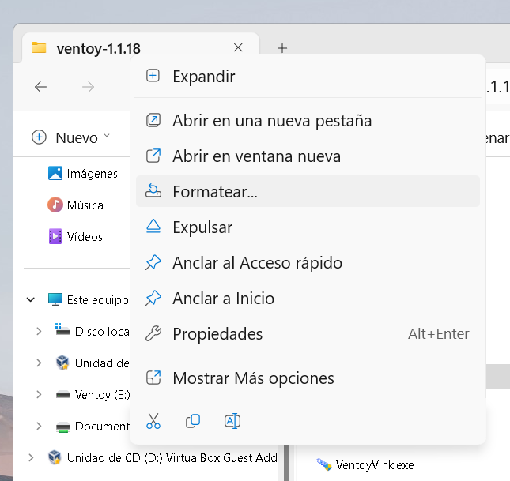

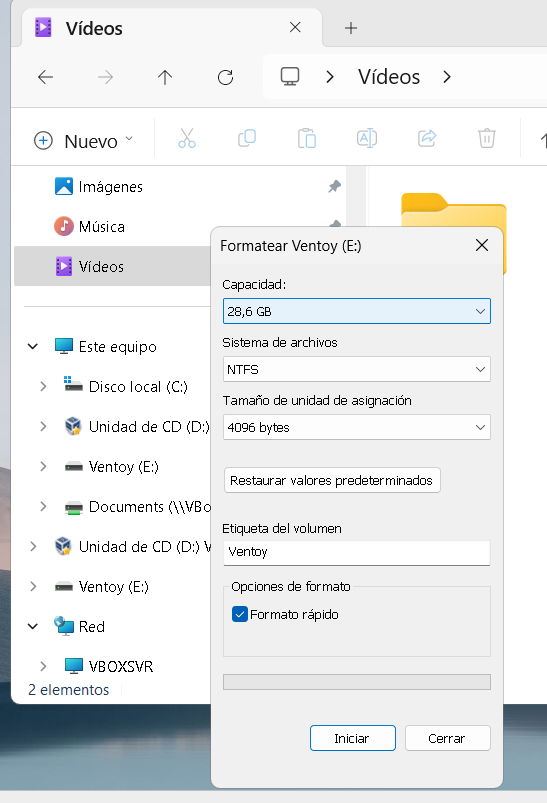

## 1.1. Descarregar Ventoy

1. Accedeix a la pàgina oficial de Ventoy: [https://www.ventoy.net](https://www.ventoy.net).
2. Descarrega el fitxer per a Windows (.zip).

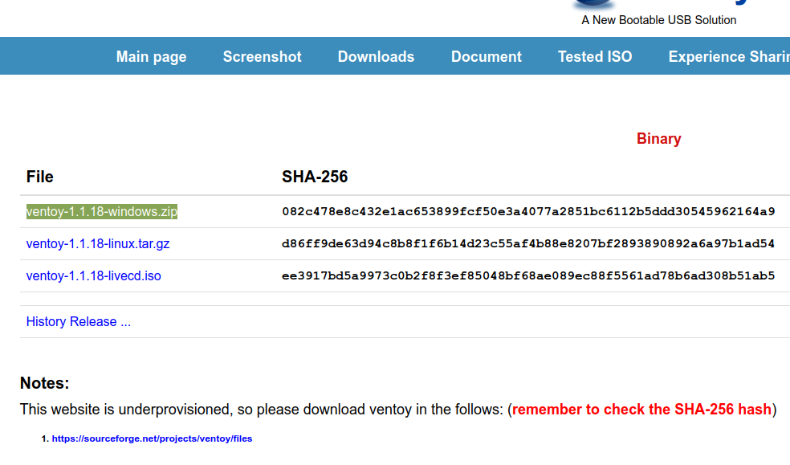
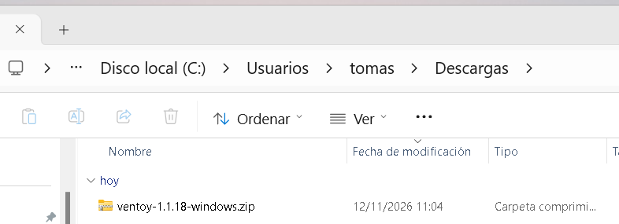

## 1.2 Descomprimir (extreure) en C:\users\usuari\Documents

1. Botó contrari i seleccionar "Extraer todo"

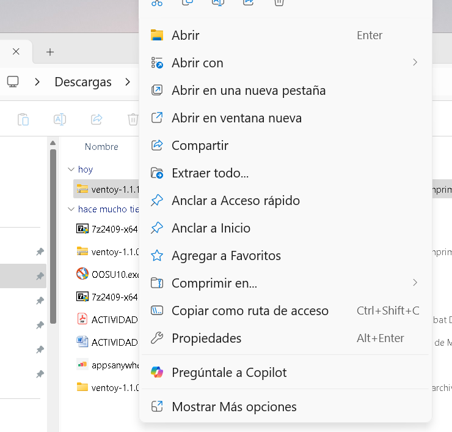

2.- Escollir destí 

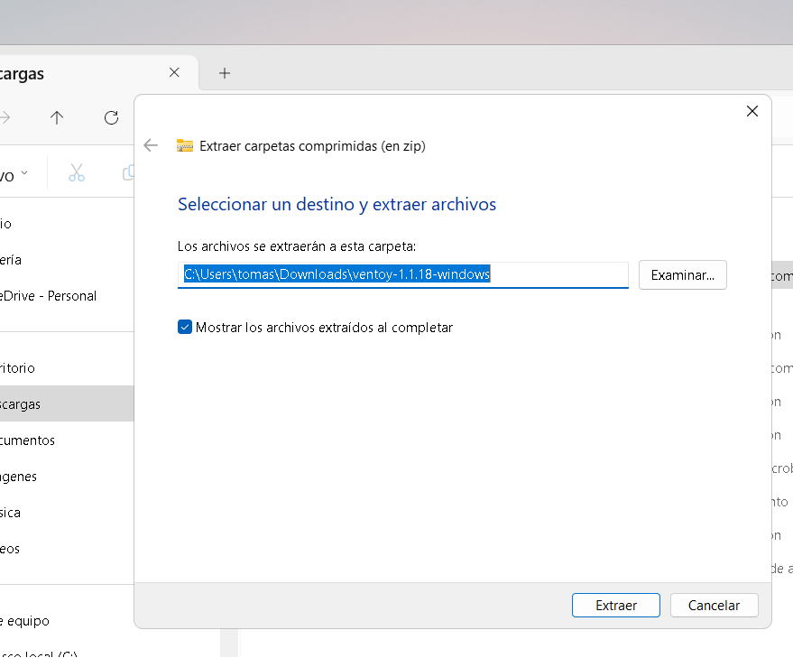

# 2 Instal·lar 

## 2.1 Connecta el pendrive

1. Connecta el pendrive que vols preparar.
2. Identifica el dispositiu del pendrive al explorador

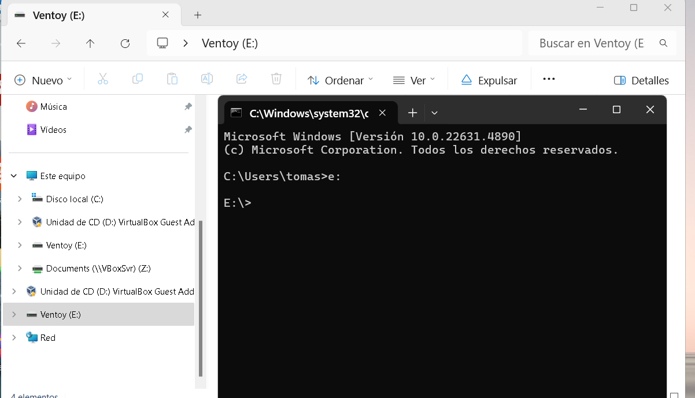

##  2.2 Instal·lar Ventoy al pendrive

Per instal·lar Ventoy al pendrive: *Localitzem el .exe que intal·la*:
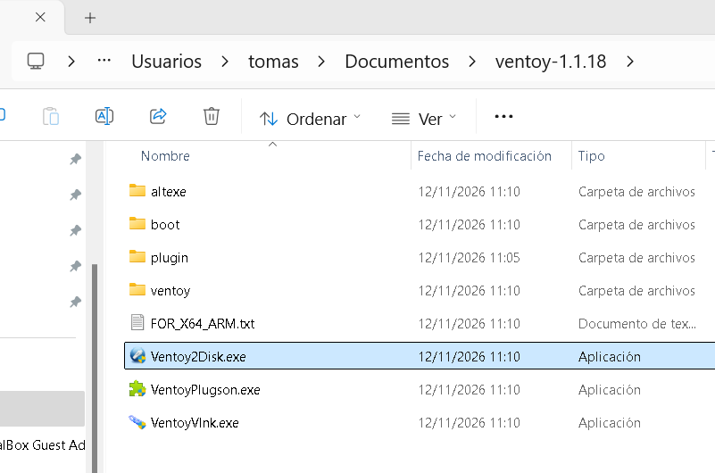

Per instal·lar Ventoy al pendrive: *Botó contrari i seleccionar Executar com administrador* el .exe:
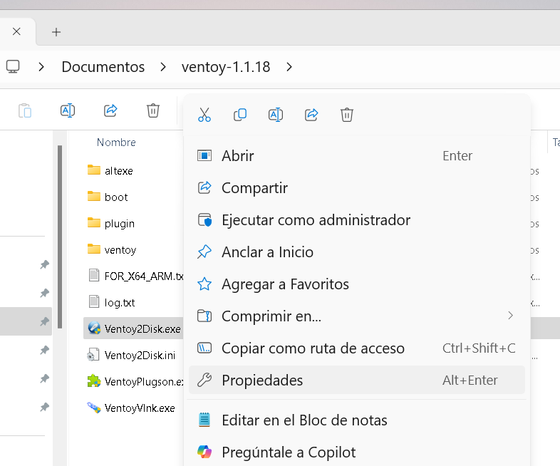

Seleccionem el PENDRIVE correcte

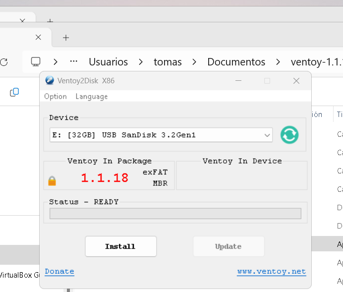
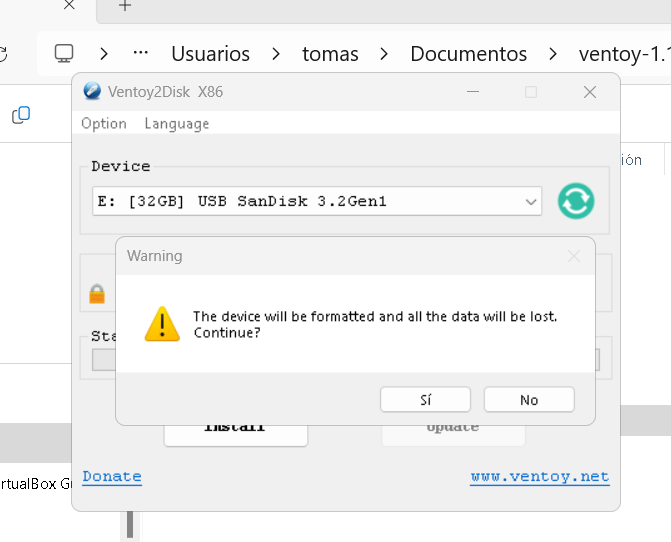
---

**Ja tenim el Ventoy instal·lat !**

# 3. Copia d’arxius ISOs

> Nota:
> Abans de copiar la ISO podem comprovar si està correctament descarregada.
> Opcional però recomanable.

## 3.1 Comprovar cada ISO del SO 

### Mirem quin codi sha256 dona el fitxer descarregat

A les webs de descàrregues de fitxers grans sempre trobarem un codi com el sha256 per a fer la comporvació.

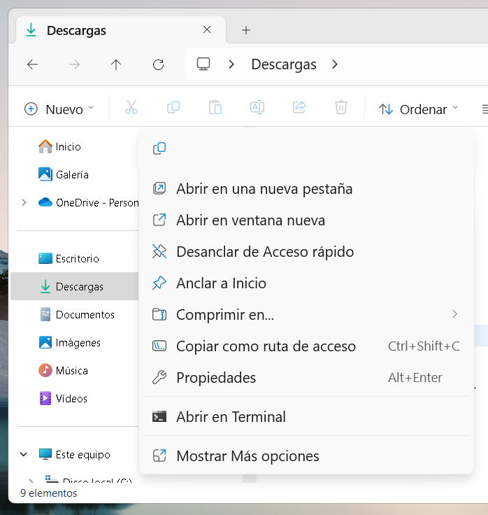

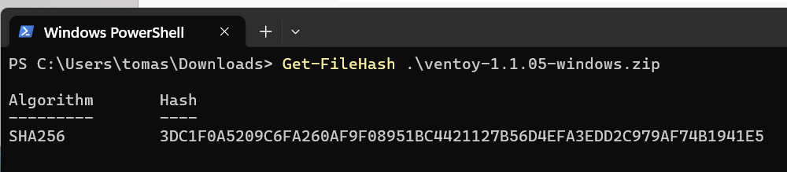

Comparem amb el que tenim a al web (el tenim a la Figura 1)

## 3.1 Copiem la ISO comprovada

Una vegada instal·lat el Ventoy, el pendrive apareixerà "buit". 

Ara pots copiar qualsevol **arxiu ISO** al pendrive i tindrem tots els SO disponibles per instal·lar.

# 4 Instal·lació del SO.

Ara hem de reinciar el PC i arrancar des del Pendrive.

1. Entrar a la UEFI i canviar el BootOrder: el primer disc a buscar ha de ser el Pen
2. Insertar el pendrive i arrancar.
3. Ens treu un menú on triarem quin SO volem instal·lar.

