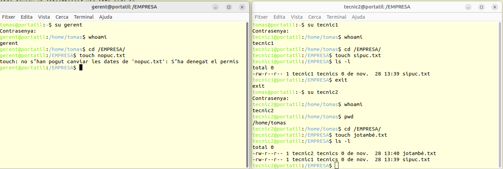

\newpage
\renewcommand\tablename{Tabla}

## Problema
En un taller de reparació, el tècnics han de guardar les fitxes de la faena que fan en una carpeta on el gerent podrà consultar-les però no modificar-les.
### Ordres 

* useradd, groupadd, usermod, userdel
* mkdir, touch
* chown, chmod
* ls, stat
* id, cat, groups

## Solució. 
Com tenim un usuari -el gerent- amb uns permisos diferents (este serà el U) i altres usuaris els agruparem en un grup (G). La resta d'usuaris (O, others), per seguretat, no els deixarem ni accedir a la carpeta.
Recordeu que per llegir el contingut d'una carpeta, un usuari, ha de tindre permís de lectura pero també d'execució per obrir-la.

### Pas 1. Crear els comptes 
Creem els comptes (usuaris i grups) que necessitem. 
* Usuari "gerent"
* Grup "tecnics" (tecnci1, tecnic2...)

```bash
tomas@portatil:~$ sudo useradd gerent -md /home/gerent
tomas@portatil:~$ sudo groupadd tecnics
tomas@portatil:~$ sudo useradd tecnic1 -md /home/tecnic1 -g tecnics
tomas@portatil:~$ sudo useradd tecnic2 -md /home/tecnic2 -g tecnics
tomas@portatil:~$ sudo passwd tecnic1
....
tomas@portatil:~$ sudo passwd tecnic2
```
**Si heu oblidat assignar el grup ( -g)** "tecnics" en la creació de cada técnic podeu arreglar-ho ...

...canviant-li el grup principal:
```bash
tomas@portatil:~$ sudo usermod tecnic1 -g tecnics
```
... o afegir-los al grup sense llevar el que ja té de grup principal (un usuari pot estar en molts grups)
```bash
tomas@portatil:~$ sudo usermod tecnic1 -aG tecnics
```
**Ara ja tenim els comptes creats!!**

### Pas 2. Creem la carpeta 

&#9888; Una carpeta compartida entre usuaris **MAI s'ha de crear dins del perfil d'un usuari** /home/pep o (C:\users\pep, en Windows), per això la creem en / o en /home

```bash
tomas@portatil:~$ mkdir /EMPRESA
mkdir: no s’ha pogut crear el directori «/EMPRESA»: S’ha denegat el permís
```
NO ens permet crear perquè en el directori "/" sols pot escriure (w) l'usuari root o qui puga emular-lo amb un sudo (o siga, els que pertanyen al grup sudo)
Comprovem-ho:
```bash
tomas@portatil:~$ ls -ld /
drwxr-xr-x 24 root root 4096 de nov.  28 12:44 /
```
Per tant, caldrà executar el mkdir diguent-li al sistema que soc (usuari tomas) un usuari sudoer (del grup sudo):

```shell
tomas@portatil:~$ sudo mkdir /EMPRESA
```
Compte! Hem creat la carpeta com sudoer, per tant tindrà assignat com a propietari i grup principal **root:root**. Comprovem-ho:

```shell
tomas@portatil:~$ ls -ld /EMPRESA/
drwxr-xr-x 2 root root 4096 de nov.  28 12:44 /EMPRESA/
```
També podem comprovar-ho amb l'ordre *stat*

```shell
tomas@portatil:~$ stat /EMPRESA/
  Fitxer: /EMPRESA/
       Mida: 4096      	Blocs: 8          Bloc d’E/S: 4096   directori
Dispositiu: 10302h/66306d	Node‐i: 30932993    Enllaços: 2
Accés: (0755/drwxr-xr-x)  UID: (    0/    root)   GID: (    0/    root)
Accés: 2026-11-28 12:44:21.589258121 +0100
Modificació: 2026-11-28 12:44:21.589258121 +0100
      Canvi: 2026-11-28 12:44:21.589258121 +0100
  Naixement: 2026-11-28 12:44:21.589258121 +0100
```

### Pas 3. Canviem el propietari i grup principal de la carpeta (chown)

Abans d'assignar permisos, hem de saber **a qui** anem a assignar-los. Ja hem vist que la carpeta és de l'usuari 0 (root) i té el grup 0 (root) com grup principal: els hem de canviar als
que necessitem.

```bash 
tomas@portatil:~$ sudo chown gerent:tecnics /EMPRESA
```
Comprovem el canvi amb el 'ls -ld' i també amb 'stat'

```bash
tomas@portatil:~$ ls -ld /EMPRESA/
drwxr-xr-x 2 gerent tecnics 4096 de nov.  28 12:44 /EMPRESA/
tomas@portatil:~$ stat /EMPRESA/
Fitxer: /EMPRESA/
       Mida: 4096      	Blocs: 8          Bloc d’E/S: 4096   directori
Dispositiu: 10302h/66306d	Node‐i: 30932993    Enllaços: 2
Accés: (0755/drwxr-xr-x)  UID: ( 1004/  gerent)   GID: ( 1013/ tecnics)
Accés: 2026-11-28 12:44:21.589258121 +0100
Modificació: 2026-11-28 12:44:21.589258121 +0100
      Canvi: 2026-11-28 13:15:34.715863906 +0100
  Naixement: 2026-11-28 12:44:21.589258121 +0100
```

### Pas 4. Assignem permisos (chmod)

Ara que la carpeta té el usuari i el grup adient, ja podem donar-los els permisos:

* Un grup d'usuaris "tecnics" que tindrà permís de **lectura (r), escriptura (w) i execució (x)**
* L'usuari "gerent" només podrà llegir en la carpeta: **lectura(r) i execució (x)**
```shell
tomas@portatil:~$ sudo chmod 570 /EMPRESA
```
Ho comprovem

```bash
tomas@portatil:~$ ls -ld /EMPRESA/
dr-xrwx--- 2 gerent tecnics 4096 de nov.  28 12:44 /EMPRESA/
tomas@portatil:~$ stat /EMPRESA/
  Fitxer: /EMPRESA/
       Mida: 4096      	Blocs: 8          Bloc d’E/S: 4096   directori
Dispositiu: 10302h/66306d	Node‐i: 30932993    Enllaços: 2
Accés: (0570/dr-xrwx---)  UID: ( 1004/  gerent)   GID: ( 1013/ tecnics)
Accés: 2026-11-28 12:44:21.589258121 +0100
Modificació: 2026-11-28 12:44:21.589258121 +0100
      Canvi: 2026-11-28 13:21:48.836791095 +0100
  Naixement: 2026-11-28 12:44:21.589258121 +0100
```


|De qui?| Octal|Binari(intern)|Descripció||
|:-|:--:|:--:|:--|:-------------|
|U|5|101|r-x|Pot entrar a la carpeta i llegir (vore) els fitxers|
|G|7|111|rwx|Poden entrar a la carpeta vore, crear, modificar o eliminar fitxers|
|O|0|000|---|No poden obrir ni entrar a la carpeta|

### Pas 5. Comprovació.
Per fer la prova podem iniciar sessions dels diferents usuaris amb **su/exit**


